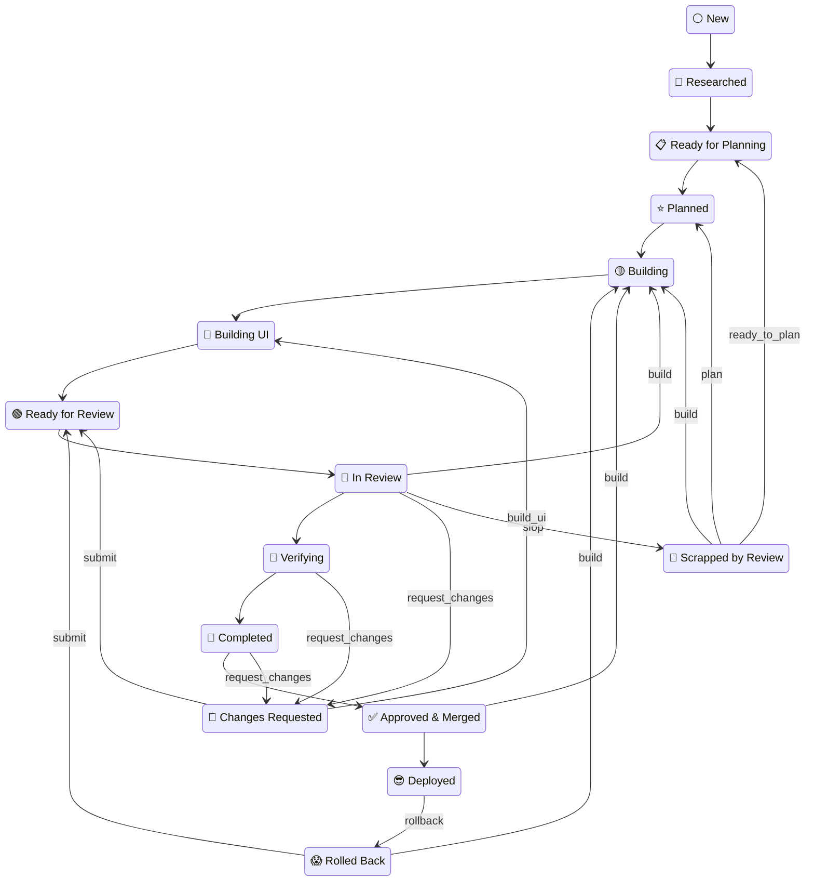
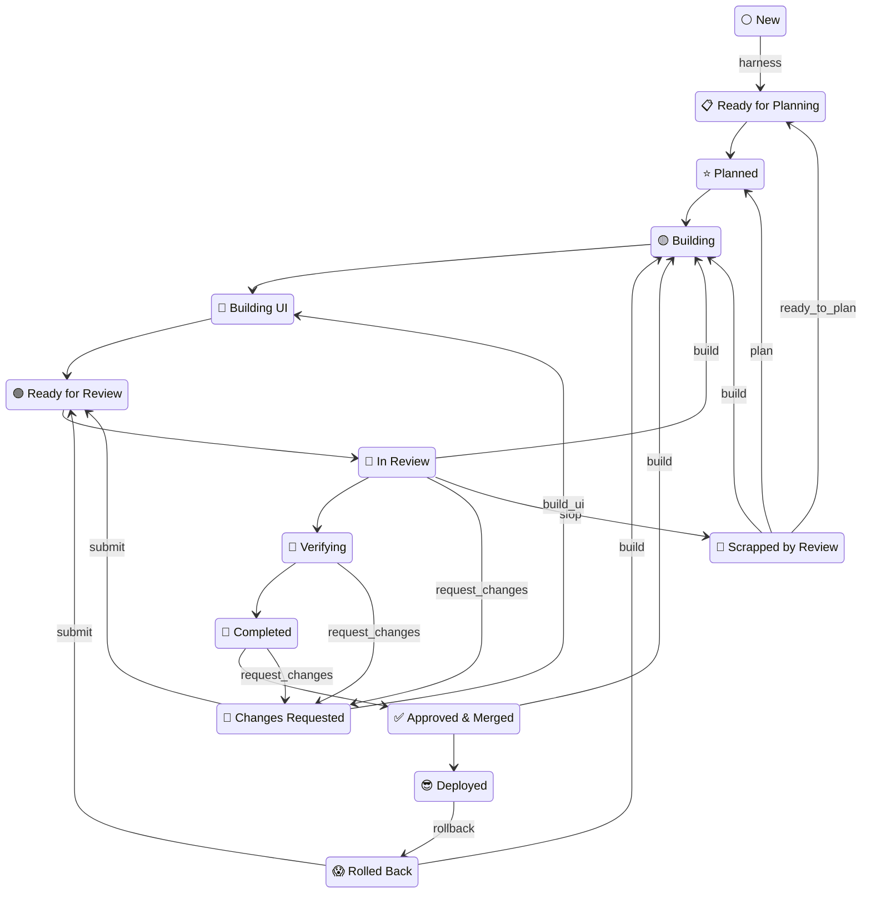
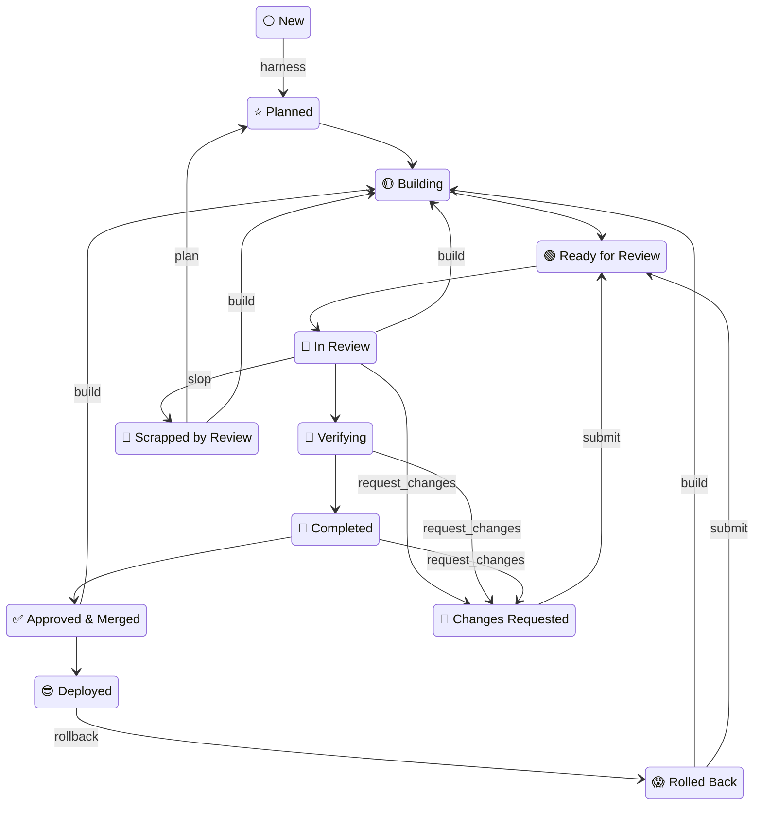
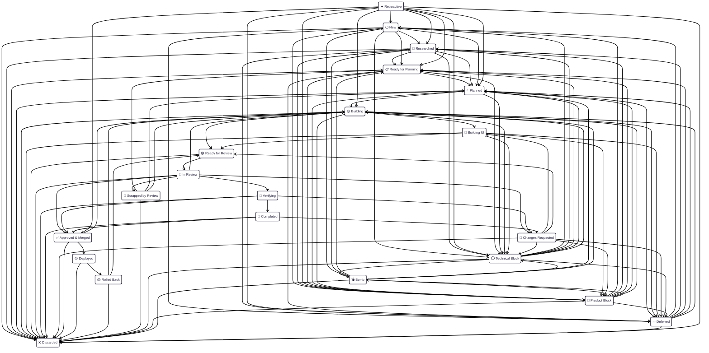

# OpenLanes Plan Lifecycle

______________________________________________________________________

> [!IMPORTANT]
> **This file is auto generated.** Please do not edit this file manually.

______________________________________________________________________

> [!NOTE]
> To regenerate it, run `ol docs --output <file>`; without `--output` it prints to STDOUT (and you can use `-o` as a short flag).
>
> A common place to keep this file is in your `.plans/README.md` file.
>
> If you are contributing to the gem, and especially after changing the state machine, please run `just update-workflow` to update this document.

______________________________________________________________________

Every project keeps its specs and plans in a `.plans/` directory at its root. This directory, like many other configuration parameters, can be set to a different location by an environment variable, for instance `.plans` can be set by `$PLANS_DIR`. However, in the case of OpenLanes, we strongly suggest that you keep your plans folder committed into your version control system, especially if more than one person is working on the project.

Each medium-to-large feature gets one folder, and the folder's **name includes its state**: the number identifies it forever, the emoji says what phase it is in, and the slug says what it is, acting as a kebab-case title of the feature.

A feature takes one of three paths, chosen by `starts:` in its `spec.md` (`research`, `planning`, `building`; the default is the project's `.openlanes.yml`).

| Starts       | Path                                                                                                                                                                                               | The harness writes   |
| :----------- | :------------------------------------------------------------------------------------------------------------------------------------------------------------------------------------------------- | :------------------- |
| **research** | ⚪ New → 🔎 Researched → 📋 Ready for Planning → ⭐ Planned → 🟡 Building → 🎨 Building UI → 🟢 Ready for Review → 👀 In Review → 🧪 Verifying → 🏁 Completed → ✅ Approved & Merged → 😎 Deployed | —                    |
| **planning** | ⚪ New → 📋 Ready for Planning → ⭐ Planned → 🟡 Building → 🎨 Building UI → 🟢 Ready for Review → 👀 In Review → 🧪 Verifying → 🏁 Completed → ✅ Approved & Merged → 😎 Deployed                 | a blank `plan.md`    |
| **building** | ⚪ New → ⭐ Planned → 🟡 Building → 🟢 Ready for Review → 👀 In Review → 🧪 Verifying → 🏁 Completed → ✅ Approved & Merged → 😎 Deployed                                                          | a one-unit `plan.md` |

`research` walks the spine from ⚪ New to 😎 Deployed. `planning` and `building` are created at ⚪ New and moved to 📋 Ready for Planning and ⭐ Planned, and the harness writes the file in the last column so that state's invariant holds. A state further along is left off a path when no agent serving it handles the state and one that does advances past it.

The arrows that leave a path are how a plan comes back. 🔴 Changes Requested is where a review, a verification or a finished plan asks for changes, and the next arrow puts it back with the builders. A looser review can send 👀 In Review straight back to 🟡 Building. 🚫 Scrapped by Review sends the work back to be planned again. 😱 Rolled Back returns a bad release to the build. A block, a deferral or a discard can leave from almost anywhere; those edges are in the machine diagram below.

### Starts at `research`

#### The Happy Path


<details>
  <summary><h5>Expand to see this flow complete with failure states</h5></summary>



</details>

### Starts at `planning`

#### The Happy Path


<details>
  <summary><h5>Expand to see this flow complete with failure states</h5></summary>



</details>

### Starts at `building`

#### The Happy Path


<details>
  <summary><h5>Expand to see this flow complete with failure states</h5></summary>



</details>

Those files are not paperwork. They are what the tool checks: a folder may not claim a state whose file is missing, and `openlanes resync dirs` renames any folder whose emoji its contents do not support. The file each state requires is in the table below.

## The number

A plan's number is its identity. It is set once, when the folder is created, and never changes: branch names, pull request titles and every `pull-requests.md` join on it, and renumbering breaks all of them silently.

The shape is always `NNN.MM`:

```
.plans/000.00━━⚪━━❯initial-spec
.plans/001.00━━🟡━━❯dev-foundation
.plans/001.01━━⏪━━❯schedule-k1-backfill   <- shipped between 001 and 002,
.plans/002.00━━⭐━━❯tenancy-households        specified afterwards
```

A folder name holds no space, so it needs no quoting in a shell, and every state emoji is a single unicode code point, so it measures the same in every terminal. Older spellings (`NNN.MM-<emoji> → <slug>`, `NNN-<emoji>--<slug>`) and the emoji they used are still read; `openlanes resync dirs` renames them.

- **`NNN` counts from `000`.** The first plan of a project is `000.00`; after that it is the highest major plus one, zero-padded to three digits.
- **`MM` is `00` for an ordinary plan** — one specified before it was built.
- **`MM` from `01` to `99` marks a retroactive plan**: work that shipped with no specification, documented after the fact. `openlanes create --after 001` takes the next free slot in the gap after 001.
- **A number is taken if any branch holds it.** "Highest" counts the primary checkout's `.plans` (archived plans included) and `.plans` on every local branch and every `origin/*` branch, read without a fetch, so a plan on an unmerged branch keeps its number.
- **Plans are created only in the primary checkout, on its default branch** (origin's HEAD, else `main`). In a linked worktree, or on any other branch, `openlanes create`, the page's new plan and `resync prs` adoption refuse and say why. The same holds for an opening `spec.md` and for `depends_on:`; every other file in a plan folder may be written from a worktree. Numbers are handed out under a lock in the shared git directory, so two creates at once cannot take the same one.

`001.01` is a **sibling of 001 that arrived later, not a part of 001**. The dot reads as containment in almost every other numbering scheme, and here it does not — which is worth saying wherever the scheme is described, because the containment reading is the one a new reader brings.

Two digits, always. One would sort into the middle of the two-digit range — `001.09` < `001.1` < `001.10` — so a single mixed-width folder silently reorders the index. Two digits also retire the question of running out: 99 slots per gap, against a gap that closes the moment the next plan is created.

> [!NOTE]
> Padding every plan to `NNN.MM` is a deliberate choice, and it costs something. A bare `018` next to `018.01` would have told you at a glance which plan was specified in advance and which was written afterwards. With uniform padding that distinction is no longer readable from the number alone — it is carried by `MM > 0`, which you have to know to look for. What padding buys is alignment and one shape to parse everywhere.

**A retroactive `spec.md` must open with a dated line saying so**, naming the pull requests it describes. It documents what exists; it does not pretend to have decided anything in advance. Anchor by *when the work merged*, not by what it is about — compare merge dates against folder creation dates (`git log --diff-filter=A`). Anchoring by topic invites an argument nobody can settle, and the number is a slot, not a claim about subject matter.

## Where a plan lives

The top of `.plans` holds only plans somebody may still work on. A plan in one of these states moves into a subfolder, and its name gains the date it got there:

| Folder              | States                            |
| ------------------- | --------------------------------- |
| `.plans/archive/`   | ✅ Approved & Merged, 😎 Deployed |
| `.plans/deferred/`  | 💤 Deferred                       |
| `.plans/abandoned/` | ❌ Discarded                      |

```
.plans/archive/001.00━━✅━━❯[2026-09-01]━━dev-foundation
```

`openlanes resync dirs` does the moving, with `git mv`, and moves a plan back to the top, undated, once its state is open again. The date is the folder's last rename in git, else `state.json`'s `updated_at`, else today. Numbers span the subfolders: a number in `archive/` is never handed out again. `openlanes plans` shows the open plans; `--all` adds the rest.

While an agent works in a plan, its lock (pid, host, start time) sits in the runtime state directory outside the repository (a legacy `locked-by.pid` in the folder is still read), and `plans` shows 🔑. The folder is never renamed while it is locked. `resync dirs` clears a lock whose process is gone from this machine, and only reports one from another.

## Starting a feature that does not exist yet

`openlanes create <two to five words>` mints the folder at ⚪ New and, for a genuinely new feature, scaffolds `spec.md` with a title and four headings, verbatim:

- `## What we are trying to achieve`
- `## Why it matters`
- `## What already exists`
- `## What research needs to settle`

`anakin-briefster` — a half-agent: it runs only inside `create` and holds no roster entry — then makes a best-effort attempt at each from what the project already has on disk — its own docs, `.plans/BACKLOG.md` when the project keeps one, anything already downloaded or already built that bears on the topic — and opens the result for a human to finish. `--no-draft` skips the attempt and leaves the headings bare; `--no-open` leaves the file for you to open.

**Nothing else belongs in that first pass.** It writes no `## Goals`, no `## Non-Goals`, no conclusions — deciding those before `researcher` and `spec-writer` have looked is choosing the answer before the research runs. Above all, it writes no heading beginning with the word "Research": that heading is not decoration, it is the 🔎 Researched invariant, so writing one — even empty — flips the folder's state out from under whoever reads it next, and the research nobody did gets skipped rather than assigned.

This is only for work that does not exist yet. `create --after <plan> --prs <n,...>` is the other path — the work already shipped, so `spec-writer` reconstructs the specification from the pull requests instead of guessing at a feature that has no facts yet to guess from.

## The states

| Symbol | Meaning                | Key                  | Files required                           | Description                                                                                       |
| :----: | :--------------------- | :------------------- | :--------------------------------------- | :------------------------------------------------------------------------------------------------ |
|   ⚪   | **New**                | `new`                | `spec.md`                                | a specification exists; it has not been planned yet                                               |
|   🔎   | **Researched**         | `researched`         | `spec.md`                                | the topic has been researched; `spec.md` carries a `## Research` chapter                          |
|   📋   | **Ready for Planning** | `ready_for_planning` | `spec.md`, `plan.md`                     | the specification is finished; `plan.md` exists and is still blank, waiting for the planner       |
|   ⭐   | **Planned**            | `planned`            | `spec.md`, `plan.md`                     | specified and planned; nobody has started building                                                |
|   🟡   | **Building**           | `building`           | `spec.md`, `plan.md`                     | the back end is under way: data, domain and the API the interface will call                       |
|   🎨   | **Building UI**        | `building_ui`        | `spec.md`, `plan.md`                     | the back end holds; the interface is being built against it                                       |
|   🟢   | **Ready for Review**   | `ready_for_review`   | `spec.md`, `plan.md`, `pull-requests.md` | every pull request is green on CI and waiting for a reviewer                                      |
|   👀   | **In Review**          | `in_review`          | `spec.md`, `plan.md`, `pull-requests.md` | a reviewer has picked it up and has not ruled yet                                                 |
|   🧪   | **Verifying**          | `verifying`          | `spec.md`, `plan.md`, `pull-requests.md` | the review approved it; verifier runs the app through How to test before anything merges          |
|   🏁   | **Completed**          | `completed`          | `spec.md`, `plan.md`, `pull-requests.md` | every pull request is `ready-to-merge`; deploy-assessor weighs each, and they merge one at a time |
|   🔴   | **Changes Requested**  | `rejected`           | `spec.md`, `plan.md`, `pull-requests.md` | the review asked for fixes; resubmit once they are made                                           |
|   ✅   | **Approved & Merged**  | `approved`           | `pull-requests.md`                       | reviewed, approved, and every pull request merged                                                 |
|   😎   | **Deployed**           | `deployed`           | `deployed.md`                            | live in production; `deployed.md` names the release, date and SHA                                 |
|   😱   | **Rolled Back**        | `rolled_back`        | `rollback.md`                            | it shipped and was pulled; `rollback.md` names what broke                                         |
|   🚫   | **Scrapped by Review** | `rewrite`            | `rewrite.md`                             | the review scrapped the work; the plan survives, the pull requests do not                         |
|   ⭕   | **Technical Block**    | `blocked`            | `blocked.md`                             | cannot proceed; `blocked.md` names what an engineer or the CTO must decide                        |
|   🛑   | **Product Block**      | `product_blocked`    | `blocked.md`                             | cannot proceed; `blocked.md` names what a product manager must decide                             |
|   💣   | **Bomb**               | `bomb`               | `blocked.md`                             | blocked too long while other plans depend on it; the run halts until a human answers              |
|   💤   | **Deferred**           | `deferred`           | `delayed.md`                             | could proceed and chose not to yet; `delayed.md` must name the trigger                            |
|   ⏪   | **Retroactive**        | `retroactive`        | —                                        | the feature is live, but has neither a specification nor a plan                                   |
|   ❌   | **Discarded**          | `discarded`          | `discarded.md`                           | dropped for good; `discarded.md` says why. A terminal state                                       |

"Files required" is a **minimum**, not an exact match: a ⚪ folder that has grown a `plan.md` still satisfies ⚪, and is ⭐ anyway. That is why `resync dirs` moves a folder to the furthest state its contents justify rather than only fixing outright lies.

Some states share their requirements on purpose, and are told apart only by the folder name. ⭕ Technical Block and 🛑 Product Block both mean "a human must decide before this can move"; *which* human is recorded nowhere but the emoji. ⭐ 🟡 🎨 🟢 👀 🧪 🏁 🔴 all mean "the work exists and pull requests are open"; whether anyone has started reviewing is written down nowhere either.

So nothing re-derives one of them from a folder's contents — otherwise every ⭕ would silently become 🛑 the first time anything resynced. A folder falling back into that group from outside lands on its weakest member, ⭐ Planned, because that is all its contents can prove.

🟣 Merged is deliberately **not** a folder state. It describes a pull request, and a folder that claimed it would be claiming a pull request's condition as its own.

## When a plan is stopped, and how it starts again

⭕ Technical Block and 🛑 Product Block mean an agent hit a question that was not its to answer and wrote `blocked.md` instead of guessing past it. Both belong to the settled group `openlanes run` leaves alone (✅ 😎 ❌ ⭕ 🛑 💣 💤), so the loop never offers a stopped plan to anybody. A loop that could move one would make the state mean nothing.

Questions are numbered `B1`, `B2`, and that numbering is how the file gets referenced in conversation and in pull requests. **`blocked.md` holds open questions and nothing else.** That is what the ⭕/🛑 invariant reads, so a file naming no question justifies neither state and `resync dirs` renames the folder out of it.

Which is how a block drains, in pieces:

1. A human writes each answer under `## Answers` as it arrives, dated and attributed to whoever decided.
1. `openlanes unblock NNN` hands the folder to `unblocker`. Nothing else reaches it: answers arriving is not a fact the tool can observe, so a human running the command *is* the signal.
1. `unblocker` folds each answered question into the document that question was stopping — `spec.md` when the answer changes what we are building or why, `plan.md` when it changes how or in what order — and deletes the question and its answer from `blocked.md`.
1. When the last question goes, the file goes with it, and the folder leaves ⭕ on the resync that follows.

An entry that names no decider, carries no date, or restates the options instead of choosing one is not an answer, and is left exactly where it is. So is any question nobody has answered yet: two answers out of five is a successful run, and the plan stays stopped on the other three, which is true. `unblocker` never answers a question itself, and never retires one for being stale — dropping a question is a human's call, and it makes the plan 💤 Deferred or ❌ Discarded, not quietly shorter.

## Transitions

| From                  | May become                    | `promote` goes to     |
| :-------------------- | :---------------------------- | :-------------------- |
| ⚪ New                | 🔎 📋 ⭐ ⭕ 🛑 💤 ❌          | 🔎 Researched         |
| 🔎 Researched         | 📋 ⭐ ⭕ 🛑 💤 ❌             | 📋 Ready for Planning |
| 📋 Ready for Planning | ⭐ ⭕ 🛑 💤 ❌                | ⭐ Planned            |
| ⭐ Planned            | 🟡 ⭕ 🛑 💤 ❌                | 🟡 Building           |
| 🟡 Building           | 🎨 🟢 ⭕ 🛑 💤 ❌             | 🎨 Building UI        |
| 🎨 Building UI        | 🟢 ⭕ 🛑 💤 ❌                | 🟢 Ready for Review   |
| 🟢 Ready for Review   | 👀 ❌                         | 👀 In Review          |
| 👀 In Review          | 🟡 🧪 ✅ 🔴 🚫 ❌             | 🧪 Verifying          |
| 🧪 Verifying          | 🏁 ✅ 🔴 ❌                   | 🏁 Completed          |
| 🏁 Completed          | ✅ 🔴 ❌                      | ✅ Approved & Merged  |
| 🔴 Changes Requested  | 🎨 🟢 ⭕ 🛑 💤 ❌             | 🎨 Building UI        |
| ✅ Approved & Merged  | 🟡 😎 ❌                      | 😎 Deployed           |
| 😎 Deployed           | 😱 ❌                         | —                     |
| 😱 Rolled Back        | 🟡 🟢 ❌                      | 🟢 Ready for Review   |
| 🚫 Scrapped by Review | 📋 ⭐ 🟡 ❌                   | ⭐ Planned            |
| ⭕ Technical Block    | ⚪ 🔎 📋 ⭐ 🟡 💣 💤 ❌       | —                     |
| 🛑 Product Block      | ⚪ 🔎 📋 ⭐ 🟡 💣 💤 ❌       | —                     |
| 💣 Bomb               | ⚪ 🔎 📋 ⭐ 🟡 ⭕ 🛑 ❌       | —                     |
| 💤 Deferred           | ⚪ 🔎 📋 ⭐ 🟡 ❌             | —                     |
| ⏪ Retroactive        | ⚪ 🔎 📋 ⭐ 🟡 ✅ ⭕ 🛑 💤 ❌ | ⭐ Planned            |
| ❌ Discarded          | _terminal_                    | —                     |

A bare promote walks the **spine** — spec → plan → build. Everything off it (blocking, deferring, rejecting) has to be named explicitly. That is the whole reason there is a machine here rather than a rename: a transition is refused when the destination's requirements are not already met, and that refusal is information — it means the phase has not actually happened yet.

<details>
<summary>Mermaid source for the diagram above </summary>



</details>

## Files allowed in a plan folder

| File               | Required by                                                                                               |
| :----------------- | :-------------------------------------------------------------------------------------------------------- |
| `spec.md`          | the specification; written first                                                                          |
| `plan.md`          | the execution plan; written from the spec                                                                 |
| `contract.md`      | the contract between the two halves of building                                                           |
| `openapi.yaml`     | the HTTP surface, when the plan has one                                                                   |
| `pull-requests.md` | 🟢 Ready for Review, 👀 In Review, 🧪 Verifying, 🏁 Completed, 🔴 Changes Requested, ✅ Approved & Merged |
| `deployed.md`      | 😎 Deployed                                                                                               |
| `rollback.md`      | 😱 Rolled Back                                                                                            |
| `rewrite.md`       | 🚫 Scrapped by Review                                                                                     |
| `blocked.md`       | ⭕ Technical Block, 🛑 Product Block, 💣 Bomb                                                             |
| `delayed.md`       | 💤 Deferred                                                                                               |
| `discarded.md`     | ❌ Discarded                                                                                              |

`contract.md` is the one file no state requires. `backend-coder` writes it before it writes code, and `frontend-coder` builds from it a round later: the interfaces the back end landed, their shapes and their errors, which files each half owns, which units may run concurrently, and the one test that proves the halves are joined rather than merely both present. No state requires it because a plan with no back-end work never needs one. When `plan.md` says the plan has an HTTP surface, `openapi.yaml` sits beside it, linked from it, and `openlanes api docs` lists every one in the project.

The units themselves live in `plan.md`, under `## Backend` and `## Frontend`. `frontend-coder` is started only when `## Frontend` holds a unit heading.

Nothing else belongs there. A folder holding notes, diagrams or scratch files is a folder nobody can audit at a glance.

## Pull requests carry the number

A pull request that implements a plan says so in its title, and is added to the table of the pull requests file `pull-requests.md` added to the `.plans` directory. Here is an example with just one pull request (but there may be several):

| Pull Request Number | Pull Request Name                                                                 |  Status |
| ------------------: | :-------------------------------------------------------------------------------- | ------: |
|                 105 | \[[020.01](A) Durable Run Events\](https://github.com/kigster/openlanes/pull/105) | Open 🟡 |

`pull-requests.md` is generated from these titles, so the prefix is the join key between a pull request and a plan, not decoration. Name branches `<user>/NNN.MM-slug` and the number carries itself from branch creation through to a merged, squashed pull request with nobody having to remember it.

`openlanes resync prs` fills in missing prefixes. It reads the branch name first and falls back to the diff only when that touches exactly one plan folder. **It refuses rather than guessing.** A wrong number does not announce itself: it files the work under a plan that did not do it, and leaves the plan that did looking untouched.

### `[dev]` when there is no plan

Not every pull request implements a feature. Dependency bumps, CI configuration, hotfixes and developer tooling implement no plan, and forcing a number onto them produces a number chosen to satisfy the rule. Those are titled:

```
[dev] Bump json from 2.21.1 to 2.21.2
```

`dev` means **"this deliberately belongs to no specification"**, and it exists so that "no plan" is *asserted* rather than merely absent. A title with no prefix is ambiguous between "no plan applies" and "nobody looked".

`resync prs` will propose it, but marks every such title as **assumed** and never applies one without you seeing it. Emitting it silently on a failed lookup would launder "I could not tell" into "there is definitely none", which is the same lie as guessing a number, told in the other direction.

### What does not deserve a retroactive plan

Most unmatched pull requests. The test is whether **somebody would need to read it** — a capability with behaviour, an interface, or invariants that are not obvious from the code. "Fix a typo", "remove dead code" and "bump a dependency" are `[dev]` and always were. Backfilling those produces an index that is longer without being more informative, which makes the real plans harder to find.

## Review labels

A pull request carries one of these at a time, set by the engine once every reviewer has reported, or by a person through `openlanes review <pr> <label>`. A new label replaces the previous one, except that `review-vulnerability` sits beside `review-rejected`. No passing verdict is given while CI is red. The engine creates or recolours every one of them on the repository when a run starts.

| Label                  | Colour   | Passing | Meaning                                                                        |
| ---------------------- | -------- | ------- | ------------------------------------------------------------------------------ |
| `ready-for-review`     | `c2e0c6` | no      | backend-coder and frontend-coder are done; the PR waits for a free review slot |
| `review-in-progress`   | `FFBE20` | no      | the reviewers have started                                                     |
| `review-rejected`      | `F90000` | no      | a reviewer rejected it                                                         |
| `review-vulnerability` | `FF0050` | no      | security-reviewer found an exploitable hole; sits beside review-rejected       |
| `review-addressed`     | `A2FF02` | no      | fixes were pushed after review-rejected; the PR waits for another review       |
| `review-passed`        | `E8E890` | yes     | no reviewer rejected it, but most did not call it great                        |
| `review-approved`      | `109a10` | yes     | no reviewer rejected it, and most called it great                              |
| `ready-to-merge`       | `5319e7` | yes     | verifier verified it and its E2E tests pass                                    |
| `auto-merged`          | `953384` | yes     | deploy-assessor judged it safe and the engine merged it                        |
| `merge-manually`       | `0e8a16` | yes     | deploy-assessor, or merge.by: human, left it for a person to merge             |

## If a real issue tracker arrives, this scheme retires

This numbering is homegrown because there is nothing else to join on. If the work moves to Linear or Jira, **the issue key replaces it**: `[EQL-142] <title>` in pull request titles, `EQL-142-<status>-<slug>` for the folder, and the issue becomes the thing `pull-requests.md` is generated against.

Recording that matters more than it looks. A numbering scheme with no stated exit becomes permanent by default: it accretes tooling, the tooling accretes rules, and by the time a real tracker shows up, migrating is a project rather than a decision. The exit is cheap only while it is written down and unbuilt.

Two things to hold to when that day comes:

- **Existing numbers are not rewritten.** A plan's number is its identity and merged pull request titles are immutable history. `000` stays `000` forever and new plans start taking issue keys. A mixed index is ugly for a while and honest permanently, which beats a renumbering that breaks every link that ever pointed at a plan.
- **Do not teach the tooling to accept issue keys before the tracker exists.** A validator that accepts `[EQL-142]` with nothing to check it against is a guard that passes anything shaped like an answer, which is worse than one that fails loudly on first use.

______________________________________________________________________

Generated by `openlanes docs` — version 4.0.0.
