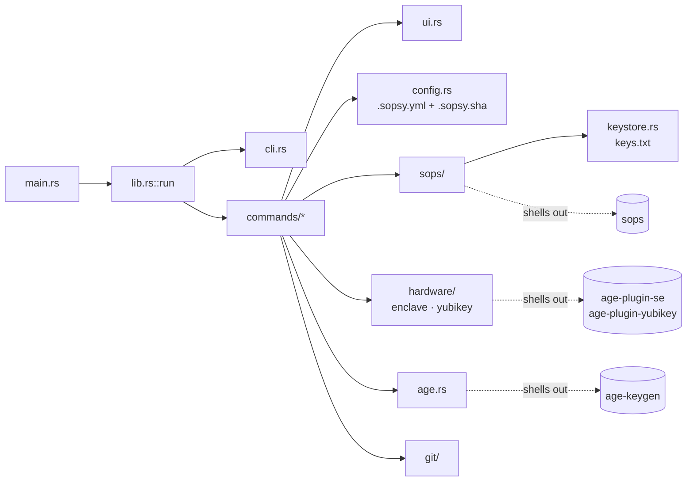
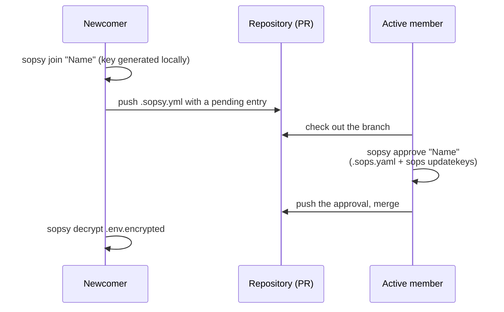

# AGENTS.md

Guidance for AI coding agents (Claude Code, Codex and others) working in this repository. `CLAUDE.md` is a symlink to this file, so there is one copy to keep current.

## What this is

`sopsy` is a Rust CLI (`edition = "2024"`) that wraps [SOPS](https://github.com/getsops/sops) and [age](https://github.com/FiloSottile/age) to give a better developer experience for managing Git-stored encrypted secrets. It is "the missing developer experience for SOPS": it orchestrates and enhances SOPS, and never replaces it.

- On macOS it targets Secure Enclave-backed identities via the external `age-plugin-se` binary.
- A YubiKey wrapper (`age-plugin-yubikey`) lives in `src/hardware/yubikey.rs`.
- `age-keygen` makes portable (break-glass and CI) keys.
- It shells out to these external tools rather than reimplementing encryption.

All commands are implemented:

- `init`, `doctor`, `edit`, `join`, `approve`
- `recipient` (`add` / `remove` / `list` / `keygen` / `break-glass` / `ci`)
- `encrypt` / `decrypt`, which write to stdout by default for direnv and wrappers. `secrets encrypt|decrypt` is a hidden alias for both.
- `types` (`list-supported-types` is a hidden alias), `check`, `deps`, `completion`

`recipient break-glass` and `recipient ci` share one portable-key ceremony, `portable_key_ceremony` in `commands/recipient.rs`:

1. Generate a portable key.
2. The operator stores it out of band (a vault, or a CI secret `SOPS_AGE_KEY`), then presses ENTER.
3. The local files are deleted.
4. The recipient is registered and every secret is re-keyed.

`sops::FileType` (dotenv / yaml / json / ini / binary) backs `--type` and auto-detects the type from the filename, stripping a trailing `.encrypted`.

## Commands

The `justfile` is the task runner (`just <recipe>`); its recipes wrap `cargo`:

- `just test`: `cargo test`
- `just fmt`: `cargo fmt`
- `just warnings`: `cargo clippy -- -D warnings`
- `just doctor`: runs `sopsy doctor`
- `just publish`: the full release gate (fmt → warnings → test → package → publish-dry-run → `cargo publish`)

Other commands:

- Run a single test: `cargo test <test_name>`.
- Run the CLI directly: `cargo run -- <subcommand>`, e.g. `cargo run -- edit secrets.yaml -- --in-place`.
- What CI runs (`.github/workflows/ci.yml`): `cargo fmt --all -- --check`, `cargo clippy --all-targets --all-features -- -D warnings`, `cargo test --all`, and coverage with `cargo llvm-cov`.
- Integration tests create git repositories and commits. If your git config signs commits, run them with `GIT_CONFIG_COUNT=1 GIT_CONFIG_KEY_0=commit.gpgsign GIT_CONFIG_VALUE_0=false`.

## Architecture

Library crate (`src/lib.rs::run` dispatches `Command`), with a thin binary in `src/main.rs` that maps errors to an exit code.

- **CLI:** defined with `clap` derive (`Cli`, `Command` in `src/cli.rs`). A new subcommand is a `Command` variant matched in `lib.rs::dispatch`, delegating to `commands::<name>::run`.
- **`doctor` is the model for checking external tooling.** It probes for required binaries with the `which` crate and reports presence with colored ✔ / ｘ output. Any feature that depends on an external tool verifies it the same way: `sops::ensure_available`, `hardware::enclave::ensure_available`, `hardware::yubikey::ensure_available`, `age::ensure_available`.
- **External-tool wrappers** live in their own modules. Each honors a `SOPSY_*_BIN` override so tests can inject fakes.
  - `sops/`: encrypt, decrypt, edit, updatekeys.
  - `hardware/`: private-key stores. `enclave.rs` wraps `age-plugin-se`; `yubikey.rs` wraps `age-plugin-yubikey`.
  - `age.rs`: `age-keygen`, portable keys.
  - `git/`.
- **`keystore.rs`** owns the per-user age `keys.txt`. It holds non-secret hardware identity handles and points every `sops` run at that file through `SOPS_AGE_KEY_FILE`. Portable private keys are never stored there.
- **Trailing arguments:** `edit` takes a file path plus `sops_args` (everything after `--`, via `#[arg(last = true)]`), forwarded to `sops`. `recipient keygen` and `join` forward trailing arguments to `age-plugin-se keygen` the same way.
- **Errors** use the `Error` / `Result` in `error.rs` (thiserror), with `color_eyre` installed in `main()`.
- **Terminal output and prompting** all go through `ui.rs` (`owo_colors`, `inquire`, `indicatif`). `SOPSY_ASSUME_YES` bypasses interactive confirmations for automation and tests.
- **Shared recipient helpers** (`current_repo_root`, `load_config`, `add_key_to_sops_yaml`, `run_updatekeys`, `ConfigSnapshot`, `rewrap_error`) are `pub(crate)` in `commands/recipient.rs` and reused by `join`, `approve` and `init`.

## Domain model

See `docs/guide-owner.md` and `docs/guide-member.md`. The secrets workflow sopsy automates:

- **Keys.** Each member holds a private age key. On macOS it lives in the Secure Enclave and never leaves the laptop. Only **public** keys are committed.
- **`.sops.yaml`.** Its `creation_rules` map a `path_regex` (e.g. `\.encrypted$`) to the list of recipient `age` public keys.
- **`.sopsy.yml`** is sopsy's own metadata:
  - each member's `name` (full or first name) and `username` (`$USER`)
  - lifecycle `state` (`pending` / `active`)
  - provenance: `requested_at` (kept after approval), `approved_at`, and `approved_by` as `"Full Name (username)"`
  - the `break_glass` marker, `encrypted_globs`, `join_request_ttl` and `sops_version`

  The recipient `init` creates is named `admin` by default and is the first entry.
- **`.sopsy.sha`** is a committed sidecar holding the SHA-256 of `.sopsy.yml`'s raw bytes, a `\n`, then the admin (first recipient) public key.
  - `Config::save` refreshes it on every write.
  - `Config::load` verifies it; a missing sidecar counts as legacy and is accepted.
  - `sopsy doctor` repairs it through `Config::load_unverified`; this is doctor's only mutation.
  - It is tamper *evidence* only: anyone can recompute it, and Enclave age keys cannot sign.
- **Onboarding is self-service.**
  - `sopsy join` records a **pending** member. The key is generated locally and is not yet in `.sops.yaml`, so it grants nothing.
  - Any active member runs `sopsy approve`. That adds the key to `.sops.yaml`, flips the member to `active`, records the provenance, and runs `sops updatekeys`.
  - `updatekeys` re-wraps the data key without re-encrypting the file bodies, so the approver must already be able to decrypt.
  - `recipient add` / `remove` are the direct equivalents.

- **Crypto reality to honor.**
  - Reading equals re-granting: any recipient holds the data key and can re-wrap it, so roles are soft guardrails, not enforcement.
  - Enclave age keys cannot sign.
  - Break-glass keys are **portable** (`age-keygen`), stored offline, and registered with `recipient break-glass` or during `init`.
- **What gets committed.** Encrypted artifacts (`.env.encrypted`, `config/*.encrypted.yaml`) are committed. Plaintext (`.env`, `*.key`, `*.pem`, `*.private`, `*.public`, credentials) never is.

When changing membership or rotation:

- Never write plaintext secrets (or private keys) to a committed location.
- Drive recipients through `.sops.yaml`.

## Product principles

- **sopsy does not replace SOPS.** It orchestrates and enhances it; SOPS stays the encryption engine. That keeps the scope crisp and the maintenance burden low.
- **Opinionated, safe defaults.** The right thing is the easy thing: plaintext `.env` is gitignored automatically, and `sopsy check` is the CI gate.
- **Fully scriptable.** Every interactive prompt has an equivalent flag, so one tool serves a human at a terminal and an unattended CI job.
- **Great diagnostics.** `sopsy doctor` output should be something people paste straight into a GitHub issue.
- **Top-notch interaction.** Use color freely, and keep prompts clear and consistent. Output must degrade to plain text under `--no-color`, `NO_COLOR` or a pipe.

## Plans

Feature work is planned in `.plans/` and managed with the `openlanes` CLI (`openlanes status`, `openlanes run <NNN>`). Each plan folder holds a `spec.md` and later a `plan.md`.
